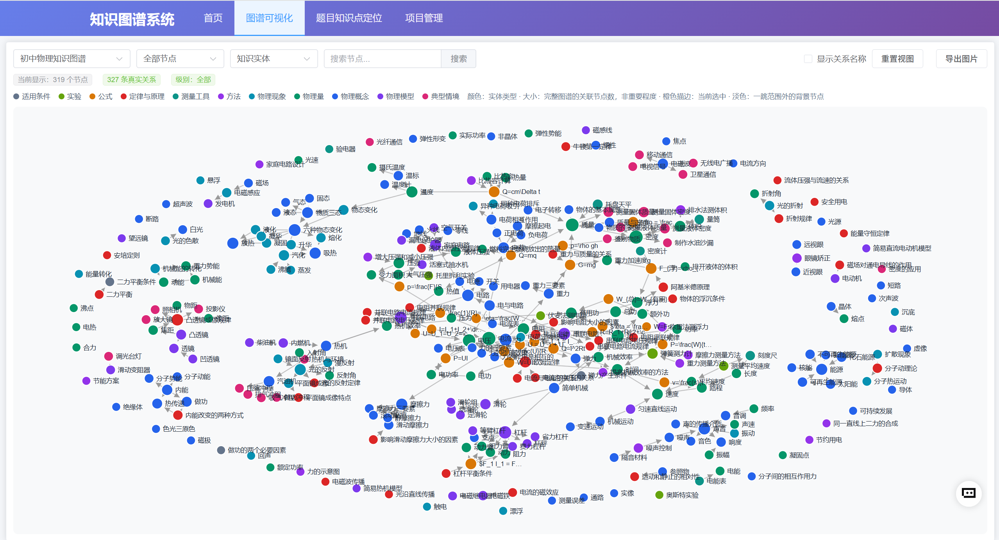
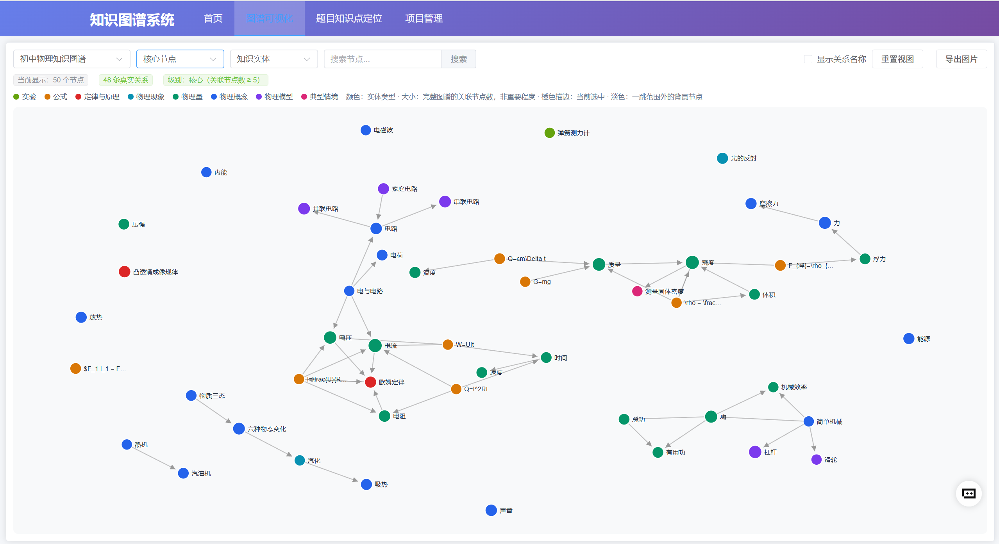
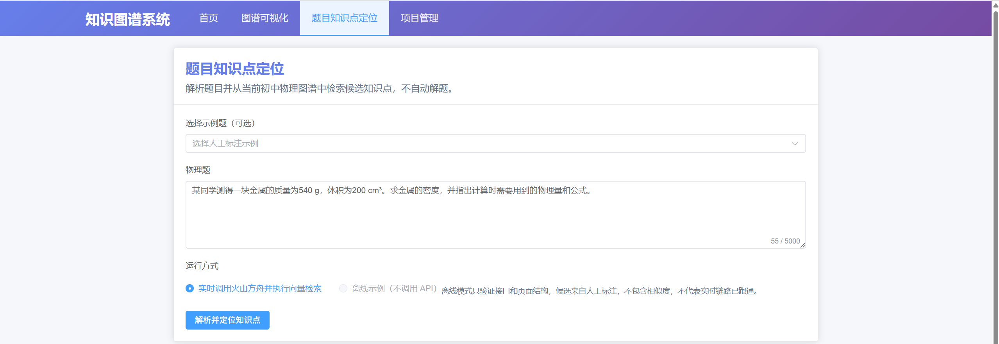
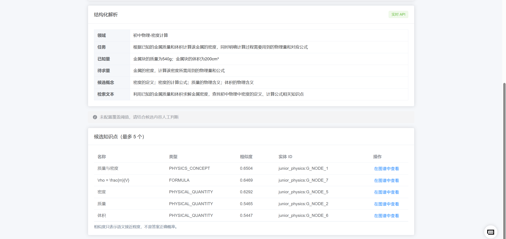
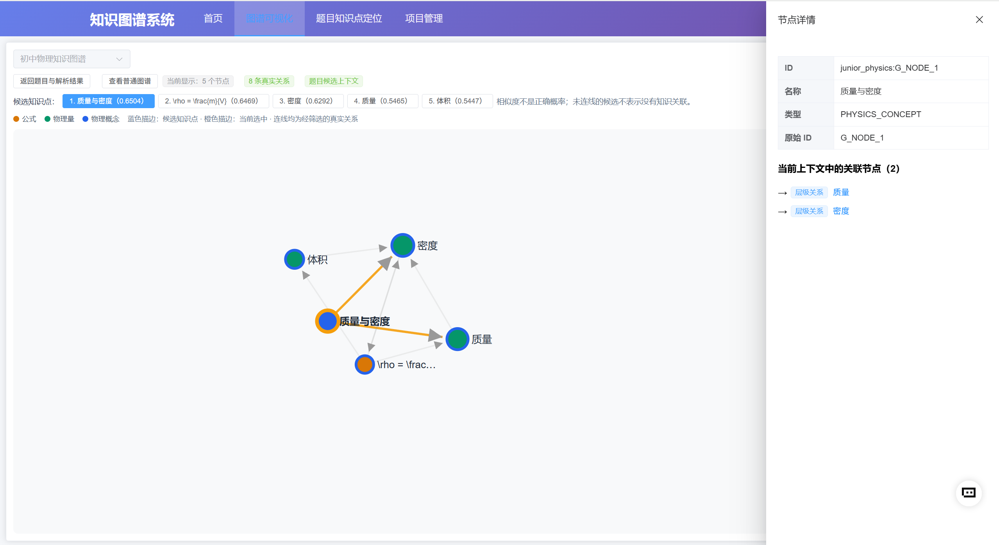

# PhyKnowledgeGraph：初中物理知识图谱

这是一个个人开发并持续维护的初中物理知识图谱项目。我从教材中抽取知识实体与关系，清洗并统一数据；为支持章节定位，参考人教版 2024 年教材目录补充册别、章、节及归属关系。项目使用 FastAPI、Neo4j、Vue 3、Element Plus、D3 和 NumPy，提供图谱可视化、搜索、节点详情，以及题目解析到候选知识点的定位链路。

## 功能展示

[观看项目演示视频](docs/videos/phyknowledgegraph-demo.mp4)

普通图谱默认展示全部 319 个知识实体，也可切换到核心节点视图。

在题目定位页输入物理题，选择实时解析与检索。

页面展示结构化解析和最多 5 个候选知识点；分数表示语义相似度。

选择候选后进入上下文图，可查看全部候选、真实关系和节点详情。图中示例显示 5 个候选、8 条关系。

还可以选择公式候选，查看它与相关物理量的关系及节点详情。

## 图谱数据

仓库包含 `data/junior_physics_2024.json`：**436 个节点、788 条有方向的关系**，其中 319 个知识实体参与题目向量检索，117 个教材目录节点用于章节定位。

数据的整理过程与结构见[数据说明](data/DATA_SOURCE.md)。

## 运行

需要 Python 3.12、Node.js/npm，以及已启动的 Neo4j Desktop 实例。完整的可复制 PowerShell 命令见 [本机运行说明](docs/LOCAL_RUN.md)。

1. 创建示例虚拟环境 `.venv`，安装 `backend/requirements.txt`；在 `frontend` 安装锁文件指定的依赖。
2. 使用虚拟环境 Python 运行 `materials/import_phykgraph_json.py --configure`，在本机输入数据库密码。
3. 运行同一脚本，将图谱 JSON 导入 Neo4j。
4. 在仓库根目录运行 `.\.venv\Scripts\python.exe -m uvicorn backend.main:app --host 127.0.0.1 --port 9000`。
5. 在 `frontend` 运行 `npm run dev -- --host 127.0.0.1`。

访问 http://127.0.0.1:5173/kgraph/graph?project=junior_physics 。后端接口文档：http://127.0.0.1:9000/docs 。

`backend/neo4j.example.json` 仅展示配置格式；真实配置由配置命令保存为 `backend/neo4j.local.json`。

## 搜索请求流程

输入至少两个字符，约 300 毫秒后调用 `/api/junior_physics/search` 获取候选。点击候选才调用 `/api/junior_physics/node/{node_id}` 获取详情，并高亮、定位该节点；每次选择都调用 `/api/junior_physics/graph?center_id=...&depth=1`，在当前基础分级图谱上补充一跳邻域，去重并替换上一次临时补充。可通过“返回分级视图”恢复。

例如搜索“电荷”会返回名称匹配的候选，可分别点击查看。开发时 `/api` 由 Vite 代理到 9000 端口。

普通图谱默认显示知识实体，可切换到“含教材目录”查看册别、章、节及其关系；核心、重要、全部级别仍可独立选择。搜索到教材节点并点击时，画布会切换到含教材目录视图以完成定位。

## 题目知识点定位

独立页面 `/kgraph/question-locator` 支持输入题目或选择离线示例。实时模式使用火山方舟 LLM 生成经过 Pydantic 校验的结构化解析，再对解析中的检索文本编码，在本地 NumPy 向量索引中取最多 5 个候选。教材目录节点不参与候选检索。

选择候选后进入题目候选上下文图：保留全部候选，只从真实知识关系中挑选一跳节点。邻居名称与解析概念相互包含、邻居全名出现在检索文本中，或邻居同时连接至少两个候选时，才进入排序；排序分为各条关系类型权重（1～3）乘以 `(相似度 + 1) / 2` 后求和，再加概念匹配 3 分、检索文本匹配 2 分、多候选连接 3 分，最多补充 8 个节点。图谱覆盖不足时不补充邻居。点击节点可查看详情；返回题目页后保留本标签页的解析结果。普通图谱页保留分级视图与一跳探索。相似度表示语义接近程度，不是正确概率。

在仓库根目录使用 PowerShell 执行 `Copy-Item backend\ai.example.json backend\ai.local.json`，再在本机配置文件中填写 API Key。仓库已提供与当前 JSON 和嵌入模型匹配的 319 个知识实体向量，按示例配置使用时无需重新构建。若更换图谱知识文本或嵌入模型，先按运行说明导入数据并核对配置，再执行 `.\.venv\Scripts\python.exe .\materials\build_local_index.py --yes` 构建索引；缺失的向量会调用付费嵌入 API，执行前应确认预计调用量。完整步骤见[本机运行说明](docs/LOCAL_RUN.md)。

## 目录

- `backend/main.py`：FastAPI 接口及 Neo4j 查询。
- `frontend/src/views/GraphView.vue`：D3 图谱、搜索与详情交互。
- `data/junior_physics_2024.json`：初中物理实体和关系。
- `data/generated/junior_physics_embeddings.npz`：当前图谱的本地知识实体向量索引。
- `data/question_eval_50.json`、`data/question_eval_results.json`：50 道评测题与逐题结果。
- `data/DATA_SOURCE.md`：数据整理过程与结构。
- `materials/import_phykgraph_json.py`：规则校验、配置、事务导入。
- `materials/verify_graph.py`：数据与 API 验证。
- `materials/build_local_index.py`：校验实体 ID 并构建本地向量索引。
- `materials/evaluate_question_locator.py`：题集校验与题目定位评测。

## 验证

后端启动后，在仓库根目录执行 `.\.venv\Scripts\python.exe materials\verify_graph.py`，预期全部 PASS。前端构建在 `frontend` 执行 `npm run build`。

重复导入相同数据使用 MERGE，不增加重复节点和关系。

## 项目来源与实现

项目最初以已有的 Kgraph 可视化代码为起点，我在此基础上持续整理和优化本地运行、图谱导入、查询交互与题目定位功能。图谱数据由我从教材解析结果中抽取、清洗和整理，具体过程见数据说明。

主要实现和整理内容包括：本机 Neo4j 配置、图谱数据校验与导入、真实关系展示、搜索候选和节点定位、节点详情与关联方向、验证脚本及运行文档。

服务默认仅监听本机地址；未提供登录鉴权，不直接作为公网服务部署。
