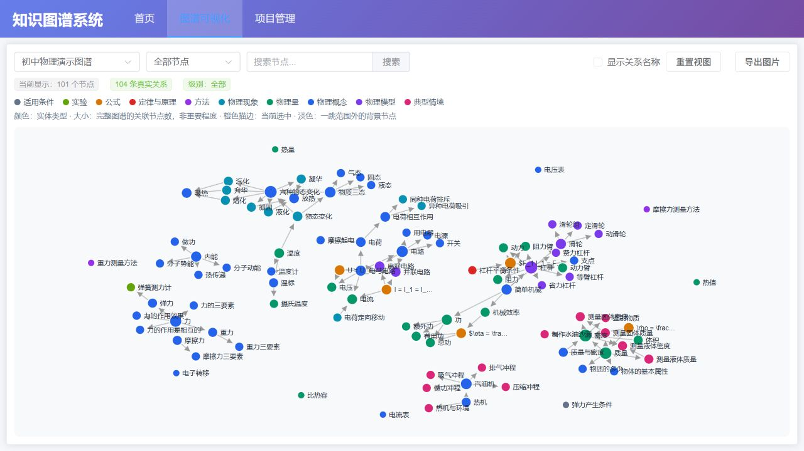
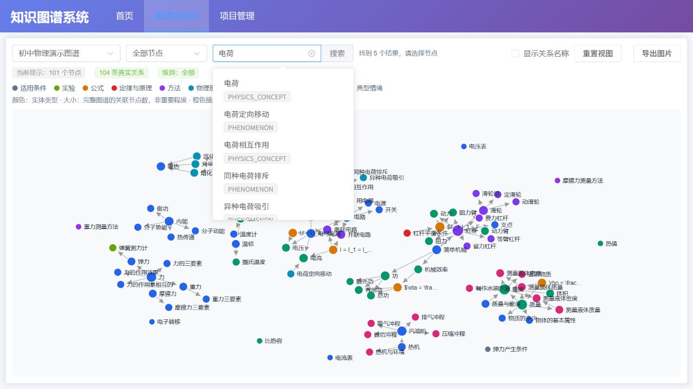
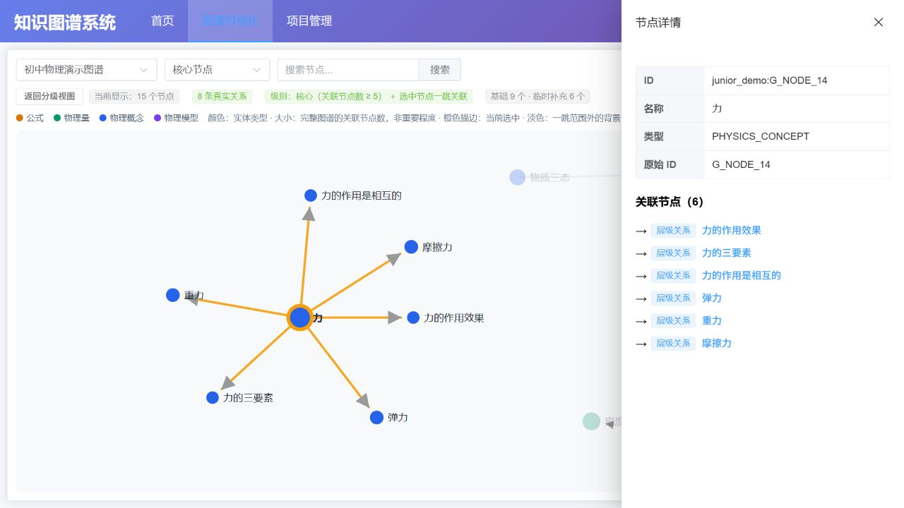

# 物理知识图谱演示

基于现有 Kgraph 项目整理的本机演示，使用 FastAPI、Neo4j、Vue 3、Element Plus、D3 和 NumPy。提供初中物理图谱可视化、模糊搜索、节点定位、属性和关联关系查看，以及题目解析到候选知识点的最小链路。

## 演示数据

仓库包含独立演示 JSON：**101 个节点、104 条有方向的关系**。

| 关系类型 | 数量 |
|---|---:|
| PARENT_CHILD | 82 |
| CONTAINS_VARIABLE | 11 |
| PREREQUISITE | 7 |
| APPLICABLE_UNDER | 4 |

历史项目曾使用 38,942 个节点、21,474 条关系的数据；该完整数据不包含在本仓库。

## 运行

需要 Python 3.12、Node.js/npm，以及已启动的 Neo4j Desktop 实例。完整的可复制 PowerShell 命令见 [本机运行说明](docs/LOCAL_RUN.md)。

1. 创建 Python 虚拟环境，安装 `backend/requirements.txt`；在 `frontend` 执行 `npm ci`。
2. 使用虚拟环境 Python 运行 `materials/import_phykgraph_json.py --configure`，在本机输入数据库密码。
3. 运行同一脚本导入演示 JSON。
4. 在仓库根目录运行 `.venv\Scripts\python.exe -m uvicorn backend.main:app --host 127.0.0.1 --port 9000`。
5. 在 `frontend` 运行 `npm run dev -- --host 127.0.0.1`。

访问 http://127.0.0.1:5173/kgraph/graph?project=junior_demo 。后端接口文档：http://127.0.0.1:9000/docs 。

`backend/neo4j.example.json` 仅展示配置格式；真实配置由配置命令保存为 `backend/neo4j.local.json`。

## 搜索请求流程

输入至少两个字符，约 300 毫秒后调用 `/api/junior_demo/search` 获取候选。点击候选才调用 `/api/junior_demo/node/{node_id}` 获取详情，并高亮、定位该节点；每次选择都调用 `/api/junior_demo/graph?center_id=...&depth=1`，在当前基础分级图谱上补充一跳邻域，去重并替换上一次临时补充。可通过“返回分级视图”恢复。

例如搜索“电荷”返回五个候选，可分别点击查看。开发时 `/api` 由 Vite 代理到 9000 端口。

## 题目知识点定位

独立页面 `/kgraph/question-locator` 支持输入题目或选择人工标注示例。实时模式使用火山方舟 LLM 生成经过 Pydantic 校验的结构化解析，再以相同模型和编码配置查询本地 NumPy 向量索引，最多返回五个候选。选择候选后通过路由进入图谱页，复用已有详情和一跳探索。

真实 API Key 只保存在被 Git 忽略的 `backend/ai.local.json`。启动 Neo4j 后，先运行 `\.phyvenv\Scripts\python.exe materials\build_local_index.py --verify-only` 校验实体映射，再运行同一命令并改用 `--yes` 构建本地索引。没有 Key 时仍可使用明确标记的离线示例。

## 目录

- `backend/main.py`：FastAPI 接口及 Neo4j 查询。
- `frontend/src/views/GraphView.vue`：D3 图谱、搜索与详情交互。
- `data/demo_junior_physics.json`：演示节点和关系。
- `materials/import_phykgraph_json.py`：规则校验、配置、事务导入。
- `materials/verify_demo.py`：数据与 API 验证。
- `materials/build_local_index.py`：校验实体 ID 并构建本地向量索引。
- `materials/evaluate_question_locator.py`：人工标注题目的 Top-5 评测。

## 验证

后端启动后，在仓库根目录执行 `.venv\Scripts\python.exe materials\verify_demo.py`，预期全部 PASS。前端构建在 `frontend` 执行 `npm run build`。

重复导入相同数据使用 MERGE，不增加重复节点和关系。导入不删除其他项目；更新 JSON 后删除的记录也不会自动从数据库删除。

## 来源与本仓库改动

本项目是在既有 Kgraph 系统基础上整理的个人演示。示例 JSON 来自用户提供的 PhyKgraph output；文件已按 PhyKgraph 的本体与关系规则校验。

本仓库整理内容包括：本机 Neo4j 配置、示例数据校验与导入、真实关系展示、搜索候选和节点定位、节点详情与关联方向、验证脚本及运行文档。保留原代码内已有注释。

这是本机演示，默认仅监听回环地址；未提供登录鉴权，不直接作为公网服务部署。历史项目配置保留，但本仓库只提供 junior_demo 的数据。

本次整理差异、验证结果及剩余依赖问题见 [发布验证记录](docs/RELEASE_CHECK.md)。
