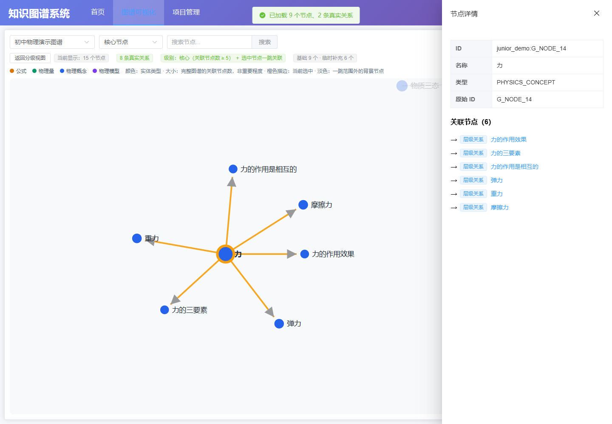

# Windows 本机演示

演示数据：PhyKgraph 初中物理图谱，101 个节点、104 条关系。它是独立示例，不能称为旧版 38,942 节点图谱的已证实子集。

随仓库提供 `data/demo_junior_physics.json`，不依赖原始桌面文件或服务器。以下命令假设项目放在 `D:\Desktop\new-project\physics-knowledge-graph-demo`，其他位置请替换路径。

## 1. 依赖与数据库

打开 Neo4j Desktop 并启动本地实例，用户数据库默认 `neo4j`。

首次安装依赖：

```powershell
Set-Location 'D:\Desktop\new-project\physics-knowledge-graph-demo'
py -3.12 -m venv .venv
& 'D:\Desktop\new-project\physics-knowledge-graph-demo\.venv\Scripts\python.exe' -m pip install -r backend\requirements.txt
Set-Location 'D:\Desktop\new-project\physics-knowledge-graph-demo\frontend'
npm.cmd ci
```

作用：建立独立 Python 环境，安装已有后端依赖和锁文件指定的前端依赖。本次如果已安装成功，不必重复执行。

## 2. 本机配置

```powershell
& 'D:\Desktop\new-project\physics-knowledge-graph-demo\.venv\Scripts\python.exe' 'D:\Desktop\new-project\physics-knowledge-graph-demo\materials\import_phykgraph_json.py' --configure
```

在任意目录执行均可。按提示输入 URI、用户名、数据库名和密码。默认 URI 为 `bolt://localhost:7687`，默认用户名及数据库名为 `neo4j`。实际配置以 Desktop 的实例信息为准。

密码输入不显示字符。配置保存在 `backend/neo4j.local.json`，已被现有 `.gitignore` 的 `*.local.json` 排除。环境变量 `NEO4J_URI/NEO4J_USER/NEO4J_PASSWORD/NEO4J_DATABASE` 优先于本机配置。

## 3. 校验和导入

```powershell
& 'D:\Desktop\new-project\physics-knowledge-graph-demo\.venv\Scripts\python.exe' 'D:\Desktop\new-project\physics-knowledge-graph-demo\materials\import_phykgraph_json.py' --validate-only
& 'D:\Desktop\new-project\physics-knowledge-graph-demo\.venv\Scripts\python.exe' 'D:\Desktop\new-project\physics-knowledge-graph-demo\materials\import_phykgraph_json.py'
```

第一条不写数据库；第二条校验通过后写入。预期打印 101 个节点、104 条关系，以及相同的数据库统计。

导入使用 `DemoJuniorPhysics` 标签和 `junior_demo:` ID 前缀，原 ID 保存为 `source_id`。保留四种真实关系：`PARENT_CHILD`、`CONTAINS_VARIABLE`、`PREREQUISITE`、`APPLICABLE_UNDER`。

节点和关系使用 MERGE 写入一个事务；对同一份数据重复执行不会增加节点或关系。导入不删除其他项目，也不自动删除文件更新后消失的旧记录。不要把不同图谱共用同一套标签和项目 ID。

## 4. 启动后端

在一个 PowerShell 窗口执行：

```powershell
Set-Location 'D:\Desktop\new-project\physics-knowledge-graph-demo'
& 'D:\Desktop\new-project\physics-knowledge-graph-demo\.venv\Scripts\python.exe' -m uvicorn backend.main:app --host 127.0.0.1 --port 9000
```

预期服务地址 `http://127.0.0.1:9000`，API 文档 `http://127.0.0.1:9000/docs`。窗口保持运行。若提示端口占用，先检查已经启动的本项目服务，不要重复启动。

## 5. 启动前端

在另一个 PowerShell 窗口执行：

```powershell
Set-Location 'D:\Desktop\new-project\physics-knowledge-graph-demo\frontend'
npm.cmd run dev -- --host 127.0.0.1
```

访问 `http://127.0.0.1:5173/kgraph/`，选择“初中物理演示图谱”。完整图谱地址：`http://127.0.0.1:5173/kgraph/graph?project=junior_demo`。

默认“全部节点”，预期 101 个节点、104 条真实关系。核心/重要级别只显示选中节点及其之间的关系。可以搜索“密度”、点击节点查看详情、拖动节点、缩放及导出图片。

### 搜索与定位

输入至少两个字符，停顿约 300 毫秒后显示候选列表，每项包含完整节点名称和类型。搜索“电荷”会显示五个候选，“电荷”本身排在前面。搜索按钮或回车用于展开结果；选择候选后才打开详情，不会自动只显示第一个结果。

点击画布节点、搜索候选或详情中的关联节点，前端都会同时查询节点详情和按 ID 的一跳邻域。选中节点以橙色描边显示，一跳邻居正常显示，其余背景节点淡化；视图缩放到能显示当前一跳范围。右侧详情面板不遮罩整张图，可以继续操作搜索框。

全部、重要、核心都保留当前基础分级图谱，再补充当前选中节点的一跳邻域。已存在的节点和同类型、同方向的关系去重，已有节点坐标保留。每次选择从基础图谱重新合并，替换上一次临时补充的邻域，不逐次累积。统计栏显示基础和临时补充节点数量；点击“返回分级视图”或切换级别可恢复基础图谱。

关联节点可以继续点击定位。方向箭头表示关系相对当前节点的方向。

在浏览器开发者工具 Network 中清除过滤框内容并选择 Fetch/XHR，可以观察：

- 输入关键词：`/api/junior_demo/search?keyword=...`。
- 选择节点：`/api/junior_demo/node/junior_demo%3AG_NODE_...`。
- 每次选择节点：`/api/junior_demo/graph?center_id=...&depth=1`。

浏览器显示请求地址为前端的 5173 端口是正常的，Vite 会将 `/api` 转发到后端 9000 端口。候选数最多显示 20 条；快速输入时旧请求不会覆盖新关键词的结果。

历史项目配置仍保留；本机尚未导入 Physics、Curriculum、Materials 的历史数据，其统计为空不代表演示导入失败。

## 6. 验证

在任意 PowerShell 目录执行：

```powershell
& 'D:\Desktop\new-project\physics-knowledge-graph-demo\.venv\Scripts\python.exe' 'D:\Desktop\new-project\physics-knowledge-graph-demo\materials\verify_demo.py'
```

需要后端运行。它检查每个节点的名称/类型、每条真实三元组、搜索、节点详情、类型过滤、二跳子图和错误响应。预期全部打印 PASS。

题目知识点定位使用被 Git 忽略的 `backend/ai.local.json` 保存火山方舟 API Key。启动 Neo4j 后，在仓库根目录依次执行：

```powershell
.\.phyvenv\Scripts\python.exe .\materials\build_local_index.py --verify-only
.\.phyvenv\Scripts\python.exe .\materials\build_local_index.py --yes
```

第一条只校验 JSON、`junior_demo:` 前缀和 Neo4j ID，不产生模型费用；第二条调用嵌入 API 并生成可复用的本地索引。访问 `http://127.0.0.1:5173/kgraph/question-locator` 使用题目定位页面。离线示例不调用模型，也不代表实时检索效果。

在 Neo4j Query 中分别执行（不是 PowerShell）：

```cypher
MATCH (n:DemoJuniorPhysics) RETURN count(n) AS nodes;
```

```cypher
MATCH (:DemoJuniorPhysics)-[r]->(:DemoJuniorPhysics)
RETURN type(r) AS relation, count(*) AS count
ORDER BY count DESC;
```

预期节点 101；关系分别为 PARENT_CHILD 82、CONTAINS_VARIABLE 11、PREREQUISITE 7、APPLICABLE_UNDER 4。

```cypher
MATCH (a:DemoJuniorPhysics)-[r]->(b:DemoJuniorPhysics)
RETURN a, r, b LIMIT 25;
```

用于查看真实连线。停止前后端时，在对应 PowerShell 窗口按 Ctrl+C；停止 Desktop 实例不会清空已保存数据。


## 图谱展示说明

图谱页使用剩余窗口空间，隐藏页脚，画布随窗口尺寸调整。默认隐藏关系文字以减少拥挤，可勾选“显示关系名称”；连线和方向箭头始终保留。

节点颜色固定表示实体类型，画布上方提供中文图例；节点大小按完整项目图谱中直接关联的不同节点数量计算，半径限制为 6～14 像素，不表示重要程度。补充邻域时使用相同的完整图谱关联数量；选中的节点以橙色描边突出显示。

只有初中物理演示图谱开放。其他项目保留名称并标注“未开放”，首页、项目管理和图谱下拉框均禁止进入；直接访问未开放项目的图谱页面显示提示。现有后端查询接口仍保留，开放状态控制的是本演示的界面入口。

本机使用 `.phyvenv` 时，将本文命令中的 `.venv` 替换为 `.phyvenv`。后端代码变更后需要重新启动后端；Vite 开发服务通常自动更新前端，必要时刷新浏览器。


### 分级筛选规则

关联节点数是完整项目中直接相连的不同节点数量，合并入向和出向连接，同一邻居只计一次。核心筛选关联节点数 ≥5，重要筛选 ≥2，全部不按关联数量过滤；当前演示分别为 9、52、101 个节点，核心包含在重要中，重要包含在全部中。

前端仍保留加载上限：核心 100、重要 500、全部 1000；这些是数量上限，不是分级阈值。未选点时，每层只显示该层节点之间的真实关系；选点后保留基础图谱并补充一跳节点和真实关系。


### 一跳探索验收

1. 切换“核心节点”：基础图为 9 个节点、2 条关系。
2. 点击“力”：保留基础 9 个节点，临时补充 6 个邻居，显示 15 个节点、8 条真实关系。
3. 搜索并选择“电路”，或点击详情里的关联节点：只保留基础图与最新邻域，上一次临时补充的其他节点消失。
4. 点击统计栏左侧“返回分级视图”：恢复 9 个节点、2 条关系，取消选中及背景淡化。
5. 在“重要节点”中搜索“热值”：即使没有邻居也可选中，保留基础 52 个节点，临时补充该节点，共 53 个。
6. 在“全部节点”中选中已有节点：仍查询和突出一跳关系，节点不重复增加。


