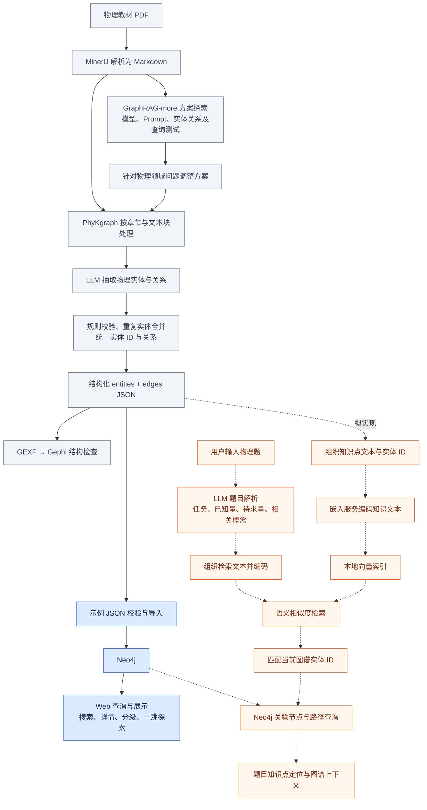
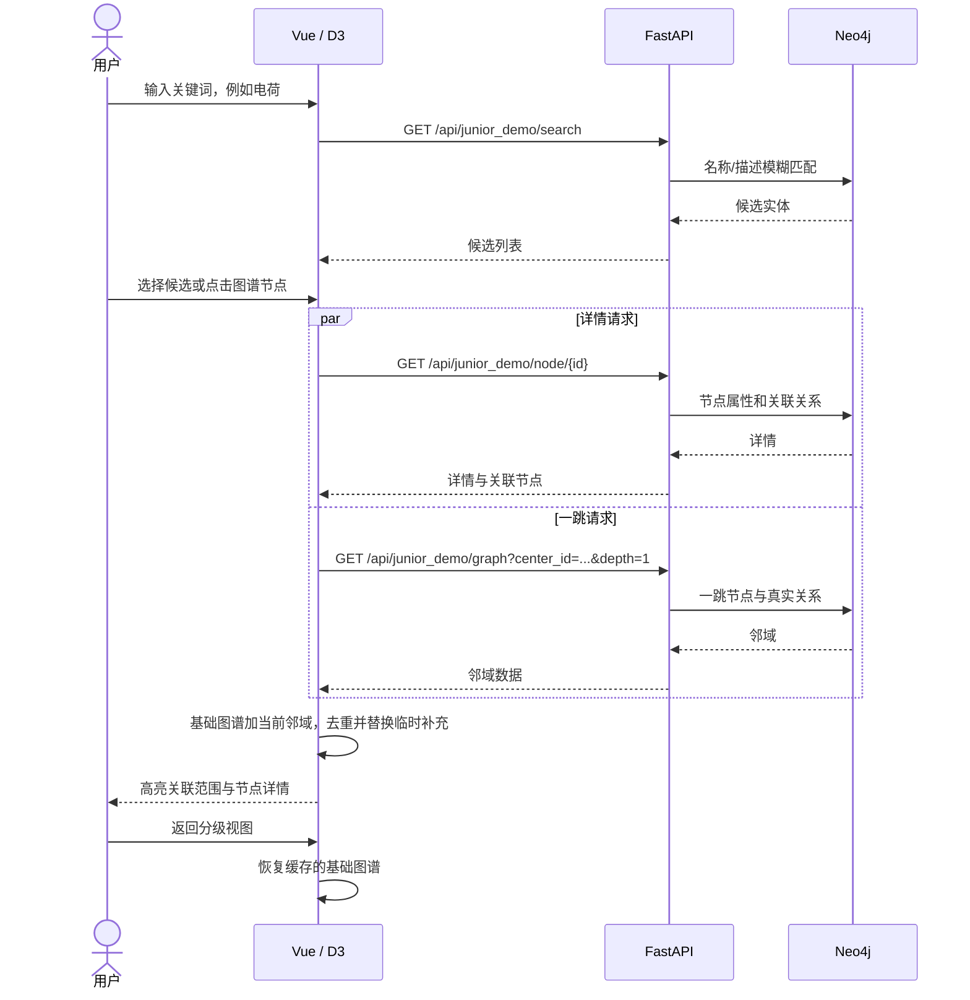

# 项目整体流程与实现状态

本图依据项目经历描述整理。当前演示仓库直接提供“JSON 校验与导入 → Neo4j → Web 搜索与图谱探索”；上游解析、抽取和 Gephi 检查的代码及证据需要从原项目/服务器补充。题目解析与本地向量检索尚未接入本演示。

## 完整流程图

蓝色：本演示可运行的环节。灰色：项目整体经历，待补原项目代码与真实材料。橙色和虚线：待接入本演示的题目查询分支。

PaddleOCR 是解析阶段最初尝试的方案，可在技术选择说明中配双栏顺序案例，不必让主流程图同时展示两条生产输入线路。

旧流程中的 BGE-M3/LanceDB 若确有服务器实现，应另附对应代码与结果。当前演示拟采用远程嵌入服务与本地向量索引，模型尚未确定；因此此图暂不写具体模型或向量库产品名。

## 当前演示的真实请求流程

## 阶段与证据

| 阶段 | 当前作品集状态 | 应补的真实材料 |
|---|---|---|
| PaddleOCR → MinerU 教材解析 | 根据项目经历描述整理 | 同一页教材与两种解析结果 |
| GraphRAG-more 探索 | 根据项目经历描述整理 | 模型/Prompt 版本、实际抽取与查询案例 |
| PhyKgraph 领域构建 | 示例 JSON 已获得并通过规则校验；本仓库未包含抽取引擎 | Markdown 文本块、抽取/合并/校验记录 |
| Gephi 图谱检查 | 根据项目经历描述整理 | GEXF 与 Gephi 截图 |
| Neo4j + Web 演示 | 当前仓库已实现 | 101/104、搜索、分级、一跳截图及运行验证 |
| 题目解析 + 语义检索 | 待接入当前演示 | 待实现 API、索引、实体映射与人工标注题目 |

“JSON 来源于 PhyKgraph output”与“可以复现该文件的全部生成过程”是不同程度的证据；作品集中按实际材料表述。
